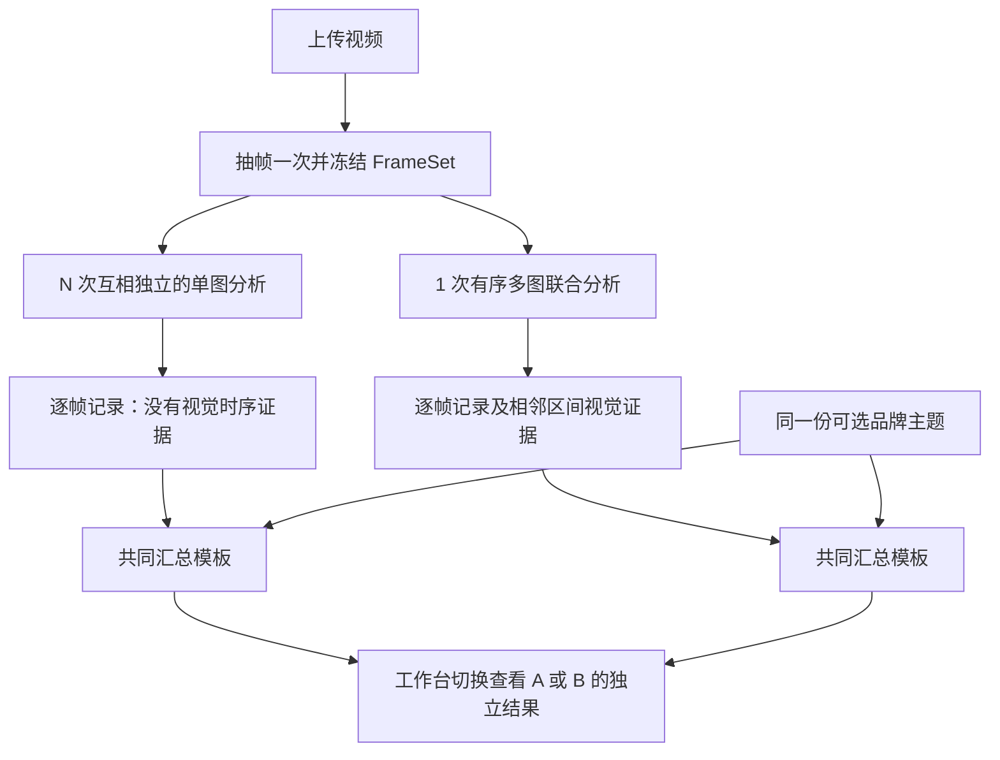

# 视频拆解双方案 POC — SPEC v0.1

日期：2026-09-23。状态：v0.1 规范已实现为本机工作台；完整模型工作流和真实业务质量仍待视频样本验证。本文技术参数为 **Proposed 实施默认值**；用户已确认的是两方案同台比较、指定模型和轻量 POC 目标。

## 1. 要回答的问题

同一视频、同一组图片、同一模型条件下，A「独立单帧 → 文本整合」和 B「有序多帧 → 联合理解」分别能否给业务提供有用的视频拆解及提示词？差异出现在哪些字段，代价是什么？

不预设 B 优于 A。多帧也可能混淆图片内容、漏帧、把相邻图片错误关联；A 也可能在静态细节识别上表现更好。

### 范围

- 上传短视频、按秒抽帧、逐帧静态特征、区间变化、全片总结。
- 两组同字段展示及相同最终输出：参考视频提示词、可选新品牌主题提示词。
- 保留调用记录、运行配置、耗时、token 用量、失败和人工评价。
- 输出可供会议讨论的 JSON 和 Markdown 报告。

### 本版暂不包含

- 视频生成、品牌商品一致性验证、模型训练 / 微调。
- 音轨识别、音乐分析、自动镜头检测、精确光流 / 摄像机轨迹求解。
- 用户体系、团队权限、复杂队列、云端部署、精装修前端。

原视频播放器可以播放声音，但模型本次只收到图片；页面和报告必须明确此点。无法因图片输入推断“无音乐”“未说某句话”。

## 2. 工作台流程

1. 上传一段视频，页面显示文件信息、时长、分辨率。
2. 可选填写新主题、商品名称、已知卖点及希望替换的内容；留空时只生成参考视频提示词。
3. 点击「运行两种方案」，只抽帧一次，生成不可变 FrameSet。
4. 后端冻结 Comparison 配置，运行 A 与 B。默认依次运行，避免两组互相争用 API 限额；A 内部允许最多 3 张图并发。
5. 先返回逐帧中间结果，再展示完整报告；某组失败时，另一组仍可完成。
6. 页面通过 A/B 切换分别查看相同帧集下的逐帧、区间与全片结果；业务人员回看原视频后评价并导出。

若开展重复对照，同一配置下交替 A→B 与 B→A；必须记录顺序。一次 Comparison 是一个成对实验，重跑不会覆盖旧结果。

## 3. 共享输入与抽帧约定

| 参数 | 默认值 / 规则 |
|---|---|
| 视频格式 | 第一版接收 MP4、MOV；是否可处理以 FFmpeg 实际解码为准 |
| 文件大小 | 最多 100 MiB，作为本机 POC 输入边界 |
| 时长 | 0 < D ≤ 60 秒；推荐首轮 5–15 秒 |
| 采样间隔 | 短视频默认 1000 ms；当 1 FPS 超过 20 帧时自动推荐满足帧数限制的间隔，可通过 Comparison 配置复现 |
| 帧数 | 最多 20 帧；不得为了适应模型静默删帧 |
| 采样目标 | 默认 1000 ms；如按 1 FPS 会超过 20 帧，推荐间隔调整为不小于 D/20 的最小 250 ms 倍数，并在任务配置中冻结。采样点为 t=k×interval，所有满足 0≤t<D 的整数 k |
| 图片 | JPEG，长边最多 1024 px，保持比例，固定质量 85，不额外裁切 |
| 顺序 | 按时间递增；两组发送完全相同的图片字节与相同 detail 参数 |
| 文件编号 | `f000`、`f001`……，编号不由模型生成 |

### 时间与证据边界

- 先读取有效视频流时长、旋转元数据和时间基准；按正常播放方向处理图片，不以更长的音轨时长代替画面时长。
- 统一解码后依据目标采样点选择时间最近的可解码帧，距离相同时取更早的帧，记录 `sample_time_ms` 和实际 `source_time_ms`，均相对视频起点。
- 若采用的解码实现无法提供可靠源 PTS，`source_time_ms=null`；不得把目标采样时刻冒充精确源帧时间。
- 本版给模型的 `timestamp_ms` 统一使用目标 `sample_time_ms`，`timestamp_basis=nominal`，单位为整数毫秒；实际源帧时间单独保存。这也避免低帧率素材重复选中源帧时产生零长度分析区间。
- 不自动在视频结束时刻附加图片；最后采样帧至视频结束部分标记为未被充分观察。
- 重复源帧、模糊、黑场可打标签，但两分支保留同样输入，不通过不同去重策略改变样本。
- 改变抽帧间隔 / 图片分辨率将创建新的 FrameSet 和 Comparison，不能混入原 A/B 结果。
- 使用较长间隔时，页面和报告记录实际间隔；同一视频内 A/B 仍使用完全相同帧，但跨视频的时间粒度可能不同，应在业务评审中考虑。

### FrameSet manifest

```json
{
  "frame_set_id": "fs_example",
  "video_sha256": "<sha256>",
  "duration_ms": 10000,
  "sample_interval_ms": 1000,
  "timestamp_basis": "nominal",
  "frames": [
    {
      "frame_id": "f000",
      "sample_time_ms": 0,
      "source_time_ms": 0,
      "timestamp_ms": 0,
      "width": 576,
      "height": 1024,
      "image_sha256": "<sha256>",
      "image_path": "frames/f000.jpg"
    }
  ]
}
```

示例仅说明字段，实际十秒任务需要列全十帧。

## 4. 两条 AI 工作流



### 4.1 A：单帧独立分析

- 每次请求只带一张图、该图 ID / 时间戳、共同规则与单帧模板。
- 请求之间没有历史消息；不带其他帧描述、全片主题或品牌目标，避免影响独立识别。
- 输出 `SingleFrameOutput`，只描述静态可见事实。不得要求单图判断推拉摇移或连续动作。
- 后端按 manifest 顺序拼成 `FrameObservation[]`；调用完成顺序不影响排列。
- 随后共同汇总节点只读取这组文字记录、时间戳和可选品牌输入。`visual_intervals=[]`。
- 汇总节点可以从描述推断相邻变化，但动态结论必须写为 inferred / unknown，并说明依据仅来自文字记录。
- N 帧正常路径为 N+1 次模型调用。

### 4.2 B：有序多帧联合分析

- 一次请求按 `[帧 ID / 时间文本, 对应图片]` 重复排列，附完整帧清单。
- 不拼成九宫格，以保留每张图片分辨率和独立对应关系。
- 输出 `SequenceOutput`：逐帧静态证据 `frames`、相邻区间 `visual_intervals`，以及覆盖完整时间顺序的连续片段 `temporal_segments`。
- `temporal_segments` 按连续帧范围分段：同一场景 / 镜头或同一动作段尽量合并；只在明显场景、镜头或内容段落变化时拆分，不因每帧姿势或字幕变化单独成段。
- 每个片段注明帧范围、采样时间、片段内容、可能动作、运镜和连续性。段落变化只能定位在相邻抽帧之间；页面用下一段首个采样时刻估算本段右边界，并标“约”，不能当作精确剪辑点或连续视频测量。
- 每张图的静态字段仍只能引用本帧；不得将其他图片的信息错写到这一帧。
- 区间记录引用相邻两张图。模型可以观察“主体画面占比变化”，但摄像机推进 / 变焦 / 主体靠近等原因必须区分推断与未知。
- 共同汇总节点读取 B 自己的结构化记录和可选品牌输入，不读取 A 结果；不额外附原图。
- 正常路径为 2 次模型调用。

这里刻意保留 A 的“文字中间层”以及 B 的“直接跨图观察”，作为待比较的完整工作流差异。两组并非调用拓扑完全相同的严格单变量实验；不能据此证明差异全部由某个模型内部机制造成。

### 4.3 共同汇总 / 提示词节点

- A/B 使用同一模板、同一模型参数、同一最终 Schema；输入证据来源随分支真实不同。
- 不告诉模型“B 应当更好”，不请求模型给两个方案打分。
- 全片分析必须先基于参考视频证据，再编写提示词；目标品牌资料只进入改编提示词。
- 输出每个相邻区间的变化、整体主题 / 风格 / 叙事结构，以及参考视频提示词。
- 品牌输入有效时额外输出 `adapted_prompt` 和改编说明；没有输入时为 null。
- `source_prompt` 忠实表达参考中可支持的拍摄特征；不足部分用克制描述，不编造精确轨迹。
- `adapted_prompt` 可以包含为新主题提出的创作安排，但必须在 `adaptation_notes` 说明哪些是建议，不写成原视频事实。
- 不凭图片臆造面料成分、价格、功效、销量、口播或音乐。

## 5. 模型与调用参数

### 已核对接入事实

- 官方接口 `https://api.deepseek.com`，`POST /chat/completions`。
- 实际检查 `/models` 返回 `deepseek-flash` 与 `deepseek-v4-pro`。
- 当前视觉文档指向 `deepseek-flash`；旧视觉实验版名称已作为兼容别名路由。调用记录保存请求名称与响应模型名称。
- 本次单图 / 十图 / JSON 最小检查均通过，但未验证业务提示词或真实商品视频。
- [官方视觉说明](https://api-docs.deepseek.com/guides/vision/)；[官方 JSON 输出说明](https://api-docs.deepseek.com/guides/json_mode/)；[实测记录](MODEL_ACCESS_CHECK.md)。

### 建议默认配置

```text
MODEL_BASE_URL=https://api.deepseek.com
MODEL_ID=deepseek-flash
MODEL_API_KEY=<从运行环境读取>
MODEL_THINKING=disabled
MODEL_TEMPERATURE=0.2
MODEL_IMAGE_DETAIL=high
FRAME_MAX_TOKENS=2048
SEQUENCE_MAX_TOKENS=16384
REPORT_MAX_TOKENS=8192
MODEL_TIMEOUT_SECONDS=120
FRAME_CONCURRENCY=3
```

- 图片放在 user 消息中，以 base64 data URL 发送；system 只带文字规则。
- `response_format={"type":"json_object"}`；提示词显式包含 json 和目标示例。
- JSON 模式仅保障 JSON 形式，字段与证据关系由应用校验。
- 输出 token 上限是工程起始值，需用真实样本检查是否截断。调整后生成新配置版本，对两组相同节点一致生效。
- 不承诺 temperature=0.2 可使结果完全确定；不伪造供应商未支持的 seed。
- 通过一次参数探针不等于所有长输出组合均已验证。

## 6. 输出字段契约

规范文件：[analysis.schema.json](schemas/analysis.schema.json)。字段必需但可有明确 unknown；不允许用“高置信度”掩盖缺少依据。

### 6.1 Claim：所有内容判断的共同结构

| 字段 | 含义 |
|---|---|
| `value` | 字符串，简短具体；未知时为 null |
| `basis` | `observed` 可直接看见 / `inferred` 推断 / `unknown` 不能判断 |
| `evidence_frame_ids` | 依据图片 ID 列表；不使用模型虚构 ID |
| `note` | 可见依据或不确定原因的简短说明；不请求完整思维链 |

规则：`unknown` 必须为 null 且解释原因；其他状态必须有非空文字和至少一个证据 ID。basis 由模型声明，程序只检查一致性，业务人员验证是否成立。

### 6.2 FrameObservation：每帧一条

固定字段：`frame_id`、`timestamp_ms`，以及以下 Claim：

| Claim 字段 | 记录内容 |
|---|---|
| `subject` | 人、商品及显著可见属性 |
| `scene` | 背景和所在场景 |
| `shot_size` | 特写 / 近景 / 中景 / 全景等；不能识别则 unknown |
| `camera_angle` | 平视 / 俯拍 / 仰拍等静态视角 |
| `composition` | 主体位置、画面占比、留白 |
| `lighting` | 可见的光线方向、软硬和明暗；不猜器材 |
| `color_palette` | 主色及冷暖倾向 |
| `visible_pose` | 当下姿态或商品摆放状态；不当成连续动作 |
| `visible_text` | 能读清的可见文字；确实无文字可写“未见可读文字”，模糊则 unknown |

不设置单帧“运镜”字段，也不强制每帧写一个完整营销主题。

### 6.3 IntervalObservation：相邻帧之间一条

固定字段：`from_frame_id`、`to_frame_id`、`start_ms`、`end_ms`。

- `visual_change`：两帧呈现了什么差异。
- `subject_motion`：人物或商品可能进行了什么动作。
- `camera_motion`：摄像机运动的可能解释；一律 inferred 或 unknown，不将推断当测量。
- `transition`：可能是连续镜头、切换、或无法判断；抽帧条件下为 inferred / unknown。
- `evidence_source`：`frame_descriptions`（A）或 `ordered_images`（B）。

N 帧输出 N−1 个区间，N=1 时为空。相邻帧之间的切换只能定位到采样区间；不填写没有依据的精确切点。

### 6.4 TemporalSegment：B 的连续片段

每个片段由 `start_frame_id` / `end_frame_id` 标识首尾包含的连续帧范围，并复制这两帧的采样时间。输出必须按序无缝覆盖输入帧；可有单帧片段，但仅用于明显独立的标题卡、片尾卡等。画面变化的真实边界只能被相邻采样时刻夹定，不能精确定位。

- `description` 总结片段的主体 / 场景 / 可见变化，证据只能引用本段帧。
- `action_progression`、`camera_motion`、`continuity` 只能为 inferred 或 unknown；稀疏抽帧不能证明连续轨迹或精确转场。
- 分段目的在于表达整体段落，不重复生成“每帧一个片段”。

### 6.5 FinalReport

- `intervals`：同上；工作台按当前 A/B 方案展示，导出报告保留两组相同时间区间的结果。
- `summary.theme`：画面表达的主题，通常是 inferred。
- `summary.visual_style`：整体视觉特点，附证据。
- `summary.content_structure`：画面 / 内容的先后组织方式，附证据。
- `summary.reusable_features`：可复用特征 Claim 列表。
- `source_prompt`：参考视频风格与结构的生成指令草稿；这是创作输出，不是找回“原始提示词”。
- `adapted_prompt`：可选新主题提示词；目标资料为空时 null。
- `adaptation_notes`：新主题替换项和新增创作安排。
- `limitations`：采样遗漏、尾部覆盖不足、没有音频、无法确定的动态等具体限制。

### 6.6 非 Schema 的必要交叉校验

1. frame ID 集合与输入完全一致，无重复、无缺失，按 manifest 顺序排列。
2. 时间戳与 manifest 一致；模型不负责计算或修正视频时长。
3. 单帧的证据仅能引用自身；区间证据引用组成区间的两帧；总结证据只能引用本次有效帧。
4. 区间恰好对应相邻帧，不跨越未输入图片，start < end。
5. B 片段有序、无间隙 / 重叠地覆盖全部输入帧；片段证据不得越出对应帧范围。
6. A 汇总的区间均为 `frame_descriptions`，动态 / 差异判断不能标 observed；B 不得伪造音频证据。
7. 未知字段说明非空；模型不确定性不能用程序强制补成肯定结论。
8. 品牌输入为空时改编字段为空；改编内容不能反写进原视频识别字段。
9. 任一违反契约的返回保留原始记录，进入有限重试；不得填入看起来成功的默认描述。

## 7. 错误处理、版本和实验约束

### 重试

- 429 / 可重试 5xx / 连接错误：最多额外 2 次；退避 2、5 秒，优先尊重供应商 Retry-After。
- 超时是否已产生计费不可确定；新尝试记录原因，不把重试当免费。
- 非法 JSON、缺帧、字段错误：同节点最多 1 次纠正重试。重新提供原始授权输入和简短校验错误；A 仍只有一图，B 仍是全部同组图片。
- `finish_reason=length` 作为截断失败；不从残缺 JSON 猜完整结果。若调整输出限额，应形成新运行配置再比较。
- 每个逻辑节点最多 3 次网络请求，合计包含网络与格式重试，避免嵌套重试无上限。
- 401 / 403 / 余额不足：直接停该分支并展示可理解原因；不自动切换其他模型。

### 部分失败

- A 某帧最终失败时，保留其他帧结果和该帧错误卡；不生成“完整 A 报告”，状态为 partial。
- B 缺帧或整体失败时保留失败响应，不自动改成单帧方案。
- 任一组不完整，Comparison 标为 incomplete；仍允许导出和讨论稳定性，但不能标记为正常效果对照。
- 进程重启后将未完成工作标 interrupted，可新建一次重跑；不自动重复扣费调用。

### 记录与比较

每次记录：输入文件 / 图片哈希、模型请求与返回 ID、运行顺序、prompt_version / template_sha256、schema_version、参数、请求数、重试数、响应状态、finish_reason、token usage、耗时、结果是否完整。

- 保存 `call_latency_ms`、`branch_wall_ms`、`comparison_wall_ms`。A 并发时，各请求耗时之和不等于用户等待时长。
- 解码时间单列。网络重试计入分支实际等待时间。
- 费用若没有明确计价配置，只展示实际 token 与“费用未配置”；有价格时注明价格日期、币种和“估算”。缓存命中 / 未命中按供应商记录拆分，不重复计算。
- 模型别名可能随供应商更新；记录真实返回信息仍不能保证跨日期完全同版本。
- 对照结果保存原始版本；业务修改作为独立注释，不覆盖原输出。

## 8. 简单前后端与目录

**建议架构**：FastAPI 提供 API 和同源 HTML，原生 JS 轮询；HTTP 客户端调用模型；进程内任务与信号量；结果写本机目录。

```text
app/
  main.py                 # 路由、页面和任务入口
  media.py                # 视频探测、抽帧、manifest
  model_client.py         # 唯一供应商适配器、用量与有限重试
  contracts.py            # 字段与跨字段校验
  workflows.py            # A/B、共同汇总、任务状态
  reporting.py            # 对照结果、JSON/Markdown 导出
  templates/index.html
  static/app.js
  static/style.css
prompts/                  # 从 PROMPTS.md 拆出可版本化模板
data/
  videos/<video_id>/
  frame_sets/<frame_set_id>/
  comparisons/<comparison_id>/manifest.json
  comparisons/<comparison_id>/A/calls/
  comparisons/<comparison_id>/B/calls/
  comparisons/<comparison_id>/comparison.json
  comparisons/<comparison_id>/review.json
```

写 JSON 使用临时文件加原子替换；进程内锁协调并发写入。单用户演示不引入数据库迁移和分布式队列。

### 最小接口

| 接口 | 输入 | 输出 / 用途 |
|---|---|---|
| `POST /api/videos` | multipart `file` | 201：video_id、时长、尺寸；解码失败返回 422 |
| `POST /api/comparisons` | video_id、可选 target_brief、sample_interval_ms | 202：comparison_id；创建独立实验配置，重复点击由 UI 禁用防重 |
| `GET /api/comparisons/{id}` | ID | 状态、进度、FrameSet、两组结果 / 错误、用量 |
| `GET /api/videos/{id}/content` | ID | 原视频播放，支持浏览器 Range 请求 |
| `GET /api/frame-sets/{id}/frames/{frame_id}` | ID | 图片文件 |
| `PUT /api/comparisons/{id}/review` | 评分、偏好、证据备注 | 保存独立业务评价 |
| `GET /api/comparisons/{id}/export?format=json或md` | ID | 可离线保存的对照报告 |

创建请求示例：

```json
{
  "video_id": "video_example",
  "sample_interval_ms": 1000,
  "target_brief": {
    "brand_name": "",
    "product_name": "",
    "theme": "",
    "verified_selling_points": [],
    "replace_instructions": ""
  }
}
```

所有目标字段均可留空；不把品牌背景暴露给前置视觉分析节点。

### 状态

- Comparison：queued → extracting → running → completed / incomplete / failed / interrupted。
- Branch：pending → analyzing → synthesizing → completed；终态还包括 partial / failed / interrupted。
- A 进度显示已返回有效帧数 / 总帧数；B 显示“联合分析中”，不虚构逐帧完成百分比。
- 页面轮询约 1 秒；状态持久化成功后才展示对应结果。

### 页面只做必要内容

1. 顶部：上传、原视频、可选新主题、运行按钮、抽帧数量。
2. 结果区提供 A「单帧独立分析」与 B「有序多帧分析」切换；每次仅展示当前方案，切换时读取已保存的结果，不重新调用模型。
3. A 以逐帧卡片展示静态识别；B 以模型产出的连续片段为主视图，片段内抽帧缩略图组成时间序列，逐帧静态识别收进片段证据折叠区。片段右边界以后一段首帧采样时刻估算并标“约”；点击采样时间可定位原视频。
4. B 的逐对相邻帧详情默认折叠，片段边界和近似采样时间显式说明；当前方案均展示全片主题、风格、结构和提示词，并区分观察、推断和未知。
5. 底部：耗时、请求 / 重试数、token、配置、业务评价。可展开原始结果和错误记录；导出仍包含 A/B 两组，供离线对照。

不需要一个可编辑画布、视频时间轴编辑器或完整后台导航体系。

## 9. 工程验收

| ID | 可观察条件 |
|---|---|
| E01 | 已知十秒样本产生目标 0–9 秒十帧；两组图片哈希一致 |
| E02 | A 每次请求仅含一张图且无其他帧上下文；B 含全部图片且顺序一致 |
| E03 | 正常路径 A=N+1 次、B=2 次；重试另外记录 |
| E04 | 两组使用同一最终字段、模型参数和汇总模板版本 |
| E05 | ID、时间、证据、unknown 规则均校验；缺帧不会悄悄补成成功 |
| E06 | 同时可看原视频、每帧结果、区间关系、整体总结和提示词 |
| E07 | 一组失败不阻止另一组结果展示；失败和中断状态准确 |
| E08 | 原始结果、重试、耗时和供应商用量可追溯，导出内容与页面一致 |
| E09 | 新主题只影响 adapted_prompt，不污染参考视频主题和特征 |
| E10 | 合成格式示例和历史结果均有标识，不冒充当前实时模型输出 |
| E11 | 新版 B 输出的片段按序、无遗漏 / 重叠地覆盖帧清单；UI 首屏按片段呈现并可展开帧证据 |

## 10. 业务评审

建议首轮 5 条：静态产品、人物动作、镜头运动、快切、较多文字。若有声音主导片段，可用于暴露本版边界，不能要求图片模型补全音轨。

逐条看两组结果，评分 1–5，并给至少一条具体证据；没有依据时选择 N/A。

| 维度 | 检查问题 |
|---|---|
| 静态描述正确性 | 人物 / 商品 / 构图 / 色彩 / 文字是否与截图一致 |
| 时间关系 | 是否把不同帧连错、把切镜当运镜、混淆主体与镜头运动 |
| 完整性 | 关键画面是否被采样覆盖，覆盖后是否仍被模型遗漏 |
| 总结依据 | 主题与结构是否有画面支持，是否虚构音频或营销事实 |
| 提示词可用性 | 内容是否具体可执行、适合参考；不等同于成片已验证 |
| 改编合理性 | 新主题是否替换正确、是否保留合适的表现形式 |

独立记录错误条数和位置，不只看平均分。最终偏好选项：A / B / 相当 / 都不可用 / 证据不足。若后续需要盲评，可随机化方案标签或切换顺序并记录映射，不必作为首日强依赖。

评审时将正确性与覆盖程度分开：有依据的 unknown 不直接算判断错误；另记“可判断但未判断”的项目。不能因某组写得更长、更肯定就判定其更好。业务对照原视频标注重要事实，并注明它是否出现在共享抽帧中；采样根本没覆盖的信息是两组共同输入限制，不能算成某一组独有的识别失误。

评分参考：1=大量关键错误，2=需要大幅修改，3=部分可用，4=少量修改可用，5=在当前样本和已观察范围内可直接参考。评分是业务判断记录，不转化为统计准确率。

可重复 1–2 条代表性样本，观察结果波动；次数、配置和运行时间写清楚。明天会议只能形成样本范围内的阶段判断，不预先写“准确率达标”。
