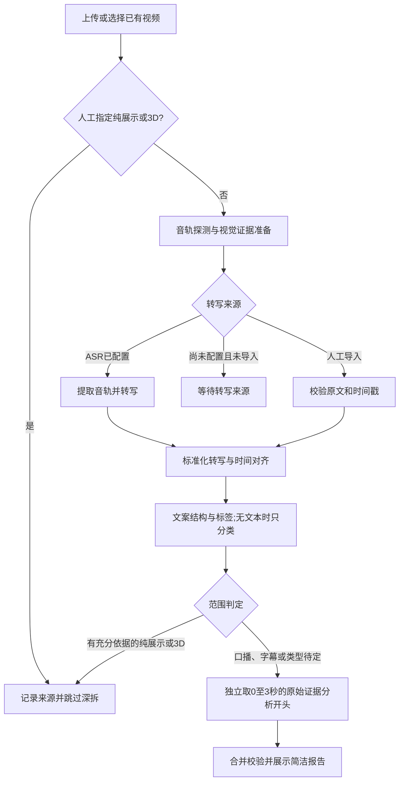

# 口播与切片视频文案分析 — SPEC v0.3

日期：2026-09-24。状态：**P1–P4 已按本轮授权实施；P5.1–P5.6 已实施并部署，真实 ASR 与三视频 C10/C20/C30 工程回归通过；已有视觉结果桥接入口、结果摘要优先与证据折叠已完成并部署到只读分享环境。** 业务语义质量仍待验收。

原规划阶段已确认：预留音频接入能力并设计文案分析；用户随后提供百炼 ASR 凭据并授权按本文件实施、验收并部署。本实现提供真实阿里云 Provider、受控 WAV 路由、disabled / fixture 接口、人工导入、视觉 / 文案 / 标签 / 前三秒分析和工作台；fixture 只用于工程联调，不能表示真实 ASR 或真实模型效果。其余业务门槛仍属 **Proposed**，实际语义质量待业务评审。

## 1. 文档入口与优先关系

| 文档 | 用途 |
|---|---|
| [产品基线](../PRODUCT_BASELINE.md) | 当前实现与下一版目标的唯一入口 |
| 本文 | 产品范围、流程、状态、接口、字段和边界规则 |
| [提示词规范](PROMPTS.md) | 各分析节点的输入、输出、约束与格式修复 |
| [实施计划](IMPLEMENTATION_PLAN.md) | 分阶段交付、依赖和实施位置 |
| [验收标准](ACCEPTANCE.md) | 无音频服务时的验收、真实接入验收、业务验收 |
| [字段契约](../schemas/content-analysis.schema.json) | 转写结果和最终分析报告的草案 JSON Schema |
| [示例说明](examples/README.md) | 合成契约示例及其使用边界 |

本目录仅约束新增“文案分析”流程。旧 [视觉 POC SPEC](../POC_SPEC.md)、[旧提示词](../PROMPTS.md) 和 `analysis.schema.json` 继续约束既有 A/B 结果，不用新字段解释旧结果。旧文档的“音频不在范围”适用于旧版。

## 2. 需求、范围与待定项

### 已确认的业务目标

业务反馈认为逐帧描述太细，希望面对大量素材时快速理解其文案表达。下一版以一条视频一份简洁报告为主，原文和画面作可回看的证据。

| ID | 需求 | 交付内容 |
|---|---|---|
| R01 | 提炼口播 / 切片视频文本 | 原始转写、文本来源、时间戳、可回看证据；摘要另存 |
| R02 | 拆解文案结构 | 按内容段解释作用，如痛点、产品介绍、福利；保留原文引用 |
| R03 | 打标签分类 | 内容形式、来源、主题分维度标记，支持多标签和未知 |
| R04 | 前三秒分析 | 0–3 秒内的口播、屏幕文字、画面和开头手法，有证据说明 |
| R05 | 纯展示 / 3D 暂不深拆 | 可人工指定跳过；自动判断有依据时跳过并保存理由 |
| R06 | 预留音频服务 | 与具体供应商解耦的适配器契约、未配置状态和后续接入步骤 |
| R07 | 无音频模型也能推进 | 建议支持人工导入带时间戳文本；显式标记来源，独立验收分析层 |
| R08 | 轻量工作台 | 一条简洁摘要、结构、标签、前三秒、展开证据；历史筛选与导出 |

R07 的人工导入方式和标签字典是实施建议。业务说“结论 OK”不等于已有逐字转写、结构或时间边界的基准标注。

### 本版边界

- 保留现有 MP4 / MOV、100 MiB、60 秒上传限制；新流程的整体视觉证据上限仍为 20 帧。不会静默截取更长视频。
- 新文案分析作为独立任务入口，不要求先运行 A/B，不重复跑两份转写，不生成新的文生视频提示词。另提供从既有 A/B 结果启动的桥接入口：只把已有视觉结果中的 `visible_text` 整理为 `content_basis=subtitle` 的人工证据，不把它冒充 ASR 或口播。
- 保留旧工作台和历史报告；本轮不修改其比较条件，也不把它们自动升级成口播分析。
- 暂不包含批量上传几千条、分布式队列、训练模型、音色识别、音乐 / 音效 / 语调评分、视频生成或效果预测。
- 对几百 / 几千条的需求，先提供完整历史分页与标签筛选；吞吐、并发和长视频另做容量评估，本 POC 不承诺其处理速度。

### Open

1. 首个 ASR 供应商 / 模型已确定并接入为阿里云百炼 `qwen-audio-3.1-asr-flash-filetrans`（北京地域、异步文件转写、首轮要求词级时间戳）；公网媒体地址、usage 记录和三条样本工程回归已完成，业务样本质量仍待评审。
2. 业务切片是否经常超过 60 秒；本版先保持现有限制。
3. 业务标签字典及“前三秒分析”是否以后包含语气 / 音效。
4. 代表性口播素材及人工基准，业务质量阈值。本文提供建议，不宣称准确率已达标。

## 3. 当前实现与复用范围

代码检查事实：`app/main.py` 已实现视频上传、Comparison 任务、历史、媒体读取、评价和 JSON / Markdown 导出；`app/media.py` 使用 `imageio-ffmpeg` 抽帧；`app/model_client.py` 调用 DeepSeek；`app/workflows.py` 保存调用记录并校验输出。现有抽帧显式使用 `-an`，没有音轨输入。

需要补齐：可靠的音频流探测、提取与时间对齐、转写适配器、导入文本、新分析节点、新任务与报告。现有 `probe_video()` 解析 FFmpeg 日志中的容器时长，尚未提供音视频流起始时间；不能把它当作已经具备精确音画对齐能力。

沿用 FastAPI、原生 HTML/CSS/JS、HTTPX、JSON 文件存储和进程内任务；不引入前端框架、数据库或 Agent 平台。统一任务准入锁，旧 Comparison 和新流程共享一个重任务槽，避免当前 POC 中相互争用配额。

## 4. 用户流程与状态



### 没有 ASR 时的行为

- 页面显示“音频转写未接入”。可创建转写任务，完成本地音轨探测后进入 `waiting_provider`；不得伪造转写内容、耗时或成功状态。
- 用户可导入 SRT 或标准 JSON。无时间戳的纯文本也可导入，但 `timing=none`，只能支持全文结构，不能给口播编时间。
- 导入时声明内容是人工听写的口播、字幕，还是来源未确认。字幕不自动变成“听到的口播”。
- 测试 fixture 仅用于显式开发模式，不出现在普通用户导入选择中；未配置或调用失败不得自动回退 fixture。
- 等待任务不占重任务槽，也不触发模型调用。填好配置或获得文本后，显式新建后续任务；不自动补跑所有历史等待项。

### 转写任务状态

`queued → probing → extracting → transcribing → completed`。

分支：`probing → no_audio`；有音轨且缺配置 → `waiting_provider`；供应商确认无人声 → `no_speech`；存在语音但不可辨认 → `unintelligible`；错误 → `failed`；服务重启 → `interrupted`。

`completed` 必须存在经过校验的非空转写；`no_audio / no_speech / unintelligible` 为可解释的业务终态，不等同服务故障。ASR 空字符串若无明确无人声信息，记 `ASR_EMPTY_RESULT` 失败，不能直接判无人声。

### 分析任务状态

`queued → preparing → analyzing → completed / partial / skipped`；其他状态为 `waiting_transcript / failed / interrupted`。

- `completed`：本任务的适用模块均生成并通过校验；不表示语义正确或 ASR 已验收。人工文本也能完成分析，必须标 `input_mode=manual`。
- `partial`：有可用模块，但其他模块缺输入、缺时间戳或调用失败。例如正文结构可用，前三秒口播无法精确定位。
- `skipped`：范围排除且有可解释的决定。不用于掩盖缺少凭据或错误。
- `waiting_transcript`：引用的转写未就绪；不占用执行槽。转写失败时结束等待并记录 `TRANSCRIPT_FAILED`，不永久轮询。
- 重启将非终态标为 `interrupted`；下一次创建新 ID，并用 `retry_of` 关联旧任务，不覆盖旧报告。

## 5. 音频接入契约

### 5.1 内部 Provider 接口（已实现 disabled / fixture / 阿里云真实 Provider）

```python
class TranscriptionProvider:
    def capabilities(self) -> ProviderCapabilities: ...
    async def transcribe(self, audio: AudioAsset, options: TranscriptionOptions) -> ProviderResult: ...
```

| 对象 | 必需字段 / 约束 |
|---|---|
| ProviderCapabilities | `configured`、`provider`、`model`、`accepted_formats`、`input_modes`（bytes / url）、`timestamp_granularity`（word / sentence / none / unknown）、时长 / 大小限制；未验证时为 unknown，不返回密钥 |
| AudioAsset | `audio_id`、`video_id`、服务端内部路径、SHA256、格式、声道、采样率、时长、音轨序号、与视频零点的偏移、转换配置；路径不由客户端任意指定 |
| TranscriptionOptions | 本地任务 ID、语言提示、可选商品词表、截止时间、时间戳要求；供应商不支持的参数应忽略并记录，或明确拒绝 |
| ProviderResult | provider request/job ID、原始响应、识别语言、文本段和词时间、明确的无人声标记（若有）、供应商 usage、耗时；原始响应只保存在服务端 |

供应商异步提交 / 轮询由适配器封装，业务只依赖标准结果。提交后立即保存远端 job ID；轮询可重试，超时后不盲目重复提交付费任务。只有确认未提交成功或供应商支持幂等时才能自动重提交。

默认适配器为 `disabled`，返回 `ASR_NOT_CONFIGURED`。第二个为仅供开发用的 `fixture`。生产配置可选择 `aliyun_dashscope`，使用 `qwen-audio-3.1-asr-flash-filetrans` 的异步 filetrans 接口；公网媒体必须通过服务端配置提供，客户端不能提交 URL 或密钥。供应商无词错误已标准化为 `no_speech`。

建议配置：`ASR_PROVIDER=disabled`、`ASR_MODEL`、`ASR_API_KEY`、`ASR_BASE_URL`、`ASR_TIMEOUT_SECONDS=180`、`ASR_MAX_RETRIES=2`、`CONTENT_FIXTURE_ENABLED=false`。未配置 ASR 仍可启动应用并查看历史。DeepSeek 与 ASR 使用各自的配置。

### 5.2 音频探测与时间处理

- 实现优先使用 FFprobe；本机 / 分享运行时若无 FFprobe，则回退到随包 FFmpeg 的媒体信息文本，识别音轨和编码，但音轨偏移记为 unknown。当前工程验收覆盖该回退探测。Windows 已验证；Linux 分享实例另需依部署验收确认。
- 默认选第一条音轨并记录，检测到多音轨提示所选序号。本版不做说话人分离或多轨混合。
- 按供应商接受格式提取；POC 可选单声道 PCM WAV，采样率跟随供应商要求，不把 16 kHz 写成所有模型的固定要求。
- 保留视频起始静音；不得剪掉静音后把第一句话当成 0 秒。记录流偏移、重采样与裁切信息，将转写时间统一映射到视频播放零点。
- `timestamp_origin=video_start`；未知偏移时 `timing=none`，保留原始时间为内部证据，不能标“精确前三秒”。
- 无音轨直接记 `no_audio`，不调用 ASR。服务故障与“无人声”分开。
- 本版不默认做人声分离；强背景音乐、重叠人声或词语无法辨认时保留缺失 / 不确定项，不能让语言模型补成确定原话。

### 5.3 标准转写字段

机器契约为 [Transcript 定义](../schemas/content-analysis.schema.json)。核心字段：

| 字段 | 规则 |
|---|---|
| `source` | `asr / manual / fixture / media_probe`，服务端根据真实入口赋值 |
| `content_basis` | `speech / subtitle / unverified`；ASR 语音文本为 speech，导入字幕保留 subtitle |
| `outcome` | `text_available / no_audio / no_speech / unintelligible`；仅 text_available 可以有文本段，文字可来自语音或导入字幕，不能把缺配置写成 no_speech |
| `timing` | `word / sentence / none`，表示实际返回粒度；导入或缺字段不得升级精度 |
| `segments[]` | `segment_id`、原文 `text`、`start_ms / end_ms`、`words[]`；无时间时两个时间均为 null |
| `words[]` | 独立 `word_id`、原文、起止毫秒；词级不是强制能力 |
| `is_fixture / reviewed_by_human` | 服务端记录来源与人工复核状态；导入不自动等于已复核 |
| `input_sha256` | ASR 输入音频或导入文件 / 文本的哈希，用于复现；探测无人声场景可空 |

所有时间采用半开区间 `[start_ms,end_ms)`，满足 `0 ≤ start < end ≤ duration_ms`。段 ID / 词 ID 唯一；首版单轨文本段按时间单调、不得相互重叠。供应商多说话人重叠结果应保留原始响应并报告不支持，不能静默摊平改写时间。

原始转写不可被摘要覆盖；人工纠正创建新版本及 `derived_from_id`，旧报告继续引用旧快照。

## 6. 分析工作流与规则

### 6.1 视觉证据准备

新建独立的内容分析 FrameSet，不复用旧 A/B 的完整报告作为事实输入。可复用同源原图，但必须核对视频哈希、帧时间与采样配置。

建议首 3 秒按 500 ms 取样，剩余时间均匀取样，总计最多 20 帧。优先保留所有落在 `[0,min(3000,D))` 的采样点，其余名额覆盖剩余时段；去重并排序，记录名义时间及实际 PTS（拿不到则 null）。不宣称覆盖了每个剪辑点或每条字幕。

`C10_VISUAL` 一次有序多图请求，只提取人物 / 商品展示、简短动作和可读屏幕文字。输出 `visual.observations`，每条绑定 frame ID 和时间；不可推断声音或完整字幕。首秒字幕闪过未采样时保留采样局限。

### 6.2 文案结构与标签

`C20_COPY_TAGS` 接收完整标准转写、视觉证据和用户来源提示。输出 `copy` 与 `tags`。

- 保留全部原文，简短摘要建议不超过 80 个汉字；默认 UI 不展开逐帧长描述。
- 按语义段归纳；不固定段数，不强制“痛点 → 产品 → 福利”。同一段允许多个作用标签。
- 初始角色字典：`pain_point / audience / product_intro / selling_point / proof / scenario / offer / call_to_action / other`。没有某类就不生成。
- 所有转写段按原顺序且恰好属于一个结构段；不能删掉无关口头语以伪装完整覆盖，无法归类可以用 other。首版不拆分单句内部的时间边界。
- 模型只返回原文段 ID、角色与简短解释；服务端根据引用计算结构段起止时间。无时间文本的结构段时间为 null；结构推断统一标 inferred。
- 来源为字幕 / 未确认文本时，摘要和结构明确标“字幕文案 / 导入文本分析”，不能写成真实口播识别。

分类分三个维度：

| 维度 | 初始值与规则 |
|---|---|
| `format_tags` | talking_head（人物讲述形式）、product_demo、animation_3d、subtitle_driven、mixed；可多选，未知时空列表并说明；人物出现不自动等于口播 |
| `origin` | clip / suspected_clip / original / null；clip 与 original 必须有用户提供的来源依据，单靠跳切不能断定切片来源 |
| `topic_tags` | 最多 6 个主题词，如跑步、马甲；每项有证据，词表由业务后续收敛 |

`talking_head` 在仅图片证据时最多标 inferred，需明确只是人物讲述形式；不能据此声称声音实际存在。标签显示依据与未知，不能输出无依据的数值准确率。

### 6.3 前三秒

`C30_HOOK` 必须独立请求，只能读取 `[0,min(3000,D))` 的证据包；不传全文、全片摘要、C20 输出、后段标签或标题，避免把后面出现的福利借到开头。

- 窗口固定从视频 0 秒开始，不从第一句口播开始。不足 3 秒时分析实际长度并说明。
- 词级时间：仅把完整落在窗口内的词拼成 `spoken_excerpt`，跨界词排除并标 `boundary_unresolved=true`。
- 句级时间：完整落在窗口内的句子可引用；跨越 3 秒的整句不得当作前三秒原话。排除跨界句，记录不完整，不按字符比例伪造词时间。
- 无时间戳：口播摘录为 unknown；仍可用有时间的画面分析开头，hook 标 limited。字幕文本不能成为 spoken_excerpt。
- 画面 / OCR 只使用窗口内采样；记录采样局限，不根据后一帧追溯前一时刻字幕。
- 输出口播摘录、屏幕文字、画面摘要、手法及简短解释；手法初始字典为 `question / pain_point / benefit / suspense / direct_demo / other`，允许无明显手法。
- 可以解释“以提问引入痛点”；不能输出“必然吸引用户”“留存率 90%”等未经数据支持的效果结论。本版不评价音色、配乐或语气。

### 6.4 范围排除

- 用户选择 `pure_display / 3d_showcase`：服务器记录用户声明，生成 skipped 报告，默认不调用 ASR 或分析模型。
- `auto`：只有音频探测 / 转写确认无语音、视觉支持纯展示或 3D、且没有待分析的实质文案时，才自动排除。仅看到 3D 画面、未配置 ASR 或未抽到字幕，都不足以排除。
- 自动范围判断在 C20 分类之后执行。无文本时 C20 只给分类、copy 为 unavailable；决定排除后最终报告 copy / hook 为 skipped，原分类输出留在调用记录。稀疏抽帧无法确认是否遗漏文案时保持 undetermined，交由用户明确选择，不把“没有抽到文字”当作“没有文案”。
- 3D 配口播、真人介绍穿插商品、动画叠加文案属于可能混合内容，继续分析或标范围待定。
- 没音轨但存在字幕时可分析字幕文案（需人工导入完整字幕）；只有零散 OCR 时只给视觉 / 标签部分结果，不伪装成完整文案。

流程图中的分类结果只控制是否执行 C30，不能进入 C30 的证据包；开头分析始终重新从标准转写和视觉清单裁剪输入。

### 6.5 结果与校验

最终 [Report](../schemas/content-analysis.schema.json) 包含 `scope`、转写快照、视觉证据、`copy`、`tags`、`hook`、限制和 provenance。`Claim` 统一为 `value / basis / evidence / note`；unknown 时 value=null 且解释原因，其余至少有一个有效证据。

证据类型为 `transcript_segment / transcript_word / transcript_result / visual_observation / metadata`。引用原话时 `quote` 必须是原段的连续子串（只规范化换行），不得润色后仍加引号。模型不得把参考素材里的文字当作系统指令。

Schema 校验之外，必须校验：视频 / 转写关联、唯一 ID、时间范围、覆盖顺序、引文匹配、来源一致、前三秒证据边界、排除条件和派生时间。校验失败最多一次格式纠正；再次失败保留已成功模块并返回 partial 或 failed，不补造结果。实现会丢弃并记录模型额外返回的服务端派生时间 / 结构字段；其他未声明字段仍触发格式校验。

## 7. HTTP 接口草案

下列文案分析 API 已实现。复用 `/api/videos`；额外提供视频元信息和任务抽帧读取。成功返回对象，列表用 `items`；新增接口统一错误结构：

```json
{"error":{"code":"ASR_NOT_CONFIGURED","message":"音频转写尚未接入。","retryable":false}}
```

现有接口的错误有 `detail` 与 `error` 两种形式；新前端需兼容两者，本版不顺手重写旧接口。

| 方法 / 路径 | 用途 | 返回 |
|---|---|---|
| GET `/api/capabilities` | 查询 ASR、分析模型、导入、只读状态 | 200；配置布尔值、时间戳能力、输入限制，不返回密钥 |
| GET `/api/videos/{video_id}/audio` | 为 URL-only ASR 提供缓存 WAV | 200 / 206；只读、服务端提取并缓存，不接受客户端路径 |
| POST `/api/transcriptions` | 为视频创建转写任务 | 202：transcription_job_id、status、status_url；缺配置后进入等待 |
| GET `/api/transcriptions/{job_id}` | 查询阶段、结果、usage 和错误 | 200；job + transcript 或 null |
| POST `/api/transcripts/import` | 导入标准 JSON、SRT 或纯文本 | 201：transcript_id、标准结果；错误格式 422 |
| GET `/api/transcripts/{transcript_id}` | 读取不可变标准结果 | 200；不存在 404 |
| POST `/api/content-analyses` | 创建文案分析任务 | 202：analysis_id、status、status_url |
| POST `/api/comparisons/{comparison_id}/content-analysis` | 基于已完成 A/B 视觉结果启动文案分析 | 202：analysis_id、comparison_id、transcript_id、`content_basis=subtitle`；仅使用已有画面文字证据 |
| GET `/api/content-analyses` | 历史分页与标签 / 状态筛选 | 200：items、total、limit、offset |
| GET `/api/content-analyses/{analysis_id}` | 任务进度、模块结果、最终报告 | 200；report 未完成为 null |
| GET `/api/content-analyses/{analysis_id}/frames/{frame_id}` | 查看该任务的抽帧证据 | 200 image/jpeg；不存在 404 |
| PUT `/api/content-analyses/{analysis_id}/review` | 保存业务评价 | 200：saved、review；不修改模型结果 |
| GET `/api/content-analyses/{analysis_id}/export?format=json\|md` | 下载报告、来源、限制及评价 | 200；报告未生成 409 REPORT_NOT_READY |

任务对象共同字段：资源 ID、video_id、status、stage、created_at / updated_at / finished_at（RFC3339 UTC，尚未结束为 null）、retry_of、error（无错误为 null）、usage（实际数据，未调用为空）。转写任务另含 audio_asset_id、remote_job_id、transcript_id / transcript；分析任务另含转写依赖、components、report / review。

HTTP 202 只代表接收任务。例如无配置任务探测后的查询结果轮廓为：

```json
{
  "transcription_job_id":"tj_example",
  "video_id":"video_example",
  "status":"waiting_provider",
  "stage":"waiting_provider",
  "audio_asset_id":null,
  "remote_job_id":null,
  "transcript_id":null,
  "transcript":null,
  "usage":null,
  "error":{"code":"ASR_NOT_CONFIGURED","message":"音频转写尚未接入。","retryable":false}
}
```

以上省略共同时间字段，仅说明状态与结果的关系。等待配置时不提取音频文件。转写独立记录探测、提取和转写状态；内容分析 components 为 visual、copy_tags、hook，各自记录真实处理状态及 error；页面依据真实模块状态显示，不虚构进度百分比。最终 job.report 使用本版 Report Schema，非终态 report 为 null。

实现还提供 `GET /api/videos/{video_id}/metadata`，便于历史报告回载原视频。只读服务在应用 API 和反向代理两层拒绝写入。当前无 ASR 时，有音轨任务进入 `waiting_provider`；纯文本可继续全文分析，但前三秒口播状态保持 unknown / limited。

capabilities 至少返回 `read_only`、`asr`、`analysis_model`、`transcript_import`、`limits`。只读时 transcript_import.enabled=false；配置存在仅表示 configured，不表示 connected / 已通过实测。未测时间戳能力明确为 unknown，不擅自声称词级。

创建转写：

```json
{"video_id":"video_example","language_hint":"zh","vocabulary":["示例品牌"],"retry_of":null}
```

客户端不能提交任意 ASR endpoint、密钥、远端文件 URL 或服务端本地路径；这些由适配器配置。转写最大重试次数由服务端限制。

导入接口使用 JSON：

```json
{
  "video_id":"video_example",
  "format":"srt",
  "content":"1\n00:00:00,200 --> 00:00:02,400\n跑步时口袋总是晃？\n",
  "content_basis":"speech",
  "reviewed_by_human":true,
  "derived_from_id":null
}
```

`format=json` 时 content 为 `{"segments":[{"text":"…","start_ms":200,"end_ms":2400}]}`；词级可另给 words。`format=text` 时 content 为非空字符串。POC 导入上限建议 1 MiB / 100,000 字符 / 1,000 段，ID 均由后端重新生成；拒绝越界、逆序、重叠或单边时间为空。用户声明不被当作供应商 ASR 验证。

创建分析：

```json
{
  "video_id":"video_example",
  "transcript_id":"tr_example",
  "transcription_job_id":null,
  "scope_hint":"auto",
  "origin_hint":"unknown",
  "retry_of":null
}
```

`transcript_id` 与 `transcription_job_id` 只能指定一个；都为空时创建 `waiting_transcript`，但人工明确排除时可直接 skipped。以后提供新文本时重新 POST 创建新分析并用 retry_of 关联，不修改原任务。引用转写 job 未结束时等待，完成后自动调度；等待不占槽，调度时重新获取原子准入锁。

分析模型未配置且需要运行模型：503 MODEL_NOT_CONFIGURED，不生成假成功。转写与分析资源必须属于同一视频及哈希，冲突返回 409 INPUT_MISMATCH；执行槽忙返回 409 TASK_BUSY（已接受且等待依赖的任务在槽空闲后执行）。

历史查询：`limit` 默认 20、最大 100，`offset` 默认 0；可按 `status / format_tag / origin / topic / input_mode` 精确筛选。先筛选后分页，按 created_at 降序、ID 次序稳定排序；多维度 AND。summary 只返回标题、标签、状态、来源和创建时间，不返回全文或音频字节。

评价字段：`verdict=usable / needs_revision / unusable / not_assessed`，`dimensions` 含 transcript_fidelity、structure_usefulness、tags_usefulness、hook_evidence（1–5 或 null），`notes`、`reviewer`、`updated_at`。这些是人工主观评分，和 CER、时间误差等客观统计分开。

常见错误：413 INPUT_TOO_LARGE；415 UNSUPPORTED_FORMAT；422 TRANSCRIPT_INVALID / TIMESTAMP_INVALID / AUDIO_ALIGNMENT_UNAVAILABLE；429 ASR_RATE_LIMITED；401/403 供应商鉴权映射 ASR_AUTH_FAILED；超时 ASR_TIMEOUT；结构 ASR_RESPONSE_INVALID / ANALYSIS_CONTRACT_INVALID。供应商错误正文脱敏记录，用户界面显示能理解的原因。

## 8. 工作台展示

- POC 主视图只展示文本提炼、文案结构、核心标签和前三秒四项结果；“视觉 A/B 实验”保留为次级调试视图，不能把旧结果标成新版完成。
- 顶部说明转写来源：真实 ASR / 人工导入 / 模拟联调 / 未接入。等待只显示真实阶段，无虚构百分比。
- 一条结果先展示全文总结 / 文案结构、核心标签和前三秒卡片；转写原文作为来源证据随后展示，视觉帧和逐条限制默认折叠，点击后查看原图、引用和局限。时间可跳转原视频，无时间则不显示可跳转时间。
- 历史、评分、导出、调用详情和扩展主题标签保留在数据 / 次级区域，不作为本轮 POC 主视图验收项。
- 旧 A/B 结果详情页将“基于此结果分析文案”作为单独动作；已有桥接报告时只显示“查看文案分析”，不会重复调用模型。A 逐帧明细与 B 连续片段证据统一放入“查看逐帧与时序证据”折叠区，避免把证据噪声放在业务主视图。
- 原文、摘要、结构解释分开呈现。前三秒单独提示时间粒度、边界不确定和输入缺失。
- 历史可筛选标签、来源与状态；跳过项保留可见，不从列表消失；unknown 可检索。
- 沿用现有较深工作区底色和可读字体对比度，不增加复杂设计系统。
- 新 URL、下载、媒体链接遵守现有 APP_BASE_PATH。只读实例隐藏导入 / 运行 / 评价按钮，API 也校验只读；Nginx GET/HEAD 限制继续生效。

## 9. 文件持久化、调用与发布

建议新增 `data/audio-assets/`、`data/transcriptions/`、`data/transcripts/`、`data/content-analyses/`，复用 `data/videos/` 和 `data/frame_sets/`。标准结果不可变，任务状态原子更新，业务评价单独保存。

每次分析冻结：视频 / 音频 / 转写哈希，来源，采样清单，供应商 / 返回模型，提示词 / Schema / 标签字典版本，模型参数，调用 ID、耗时、usage、错误和格式修复。供应商未返回费用时仅记录时长 / usage，费用为 unknown，不伪造估值。

新提示词与 Schema 独立命名，不改动旧运行时正在读取的 docs/PROMPTS.md 和 docs/schemas/analysis.schema.json。将来打包必须携带新旧 docs、schemas、examples，因为当前运行时依赖这些文件。

发布按本地验收 → 备份代码与数据 → 发布应用及运行时文档 → 启动检查 → 在已有独立代理路径核对读操作的顺序进行。当前云端分享环境继续只读；ASR 凭据只写入服务器 systemd 环境文件，任务创建仅在回环管理实例开放，不向公网开放写入。

回滚恢复应用及其文档版本，保留新增目录和旧结果；不删除数据、不把新版任务强行交给旧 Schema 解读。

## 10. 资料与验证边界

- 当前 DeepSeek 视觉输入：[官方 Vision](https://api-docs.deepseek.com/guides/vision/)。项目已验证图像能力，不据此推断其支持音频。
- ASR 能力参考：[阿里云语音识别](https://help.aliyun.com/zh/model-studio/asr-model)、[文件识别与时间戳](https://help.aliyun.com/en/model-studio/non-realtime-speech-recognition-user-guide)。三条测试视频已用于工程回归，仍需业务提供带基准的口播、字幕和边界样本。

本轮文档完整性检查与未来应用验收必须分别记录，详见 [验收标准](ACCEPTANCE.md)。
